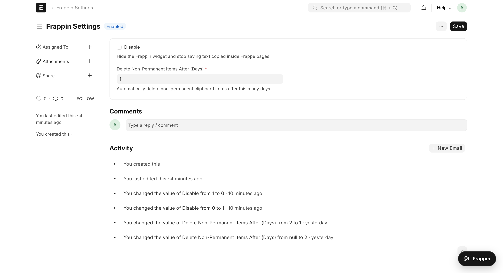
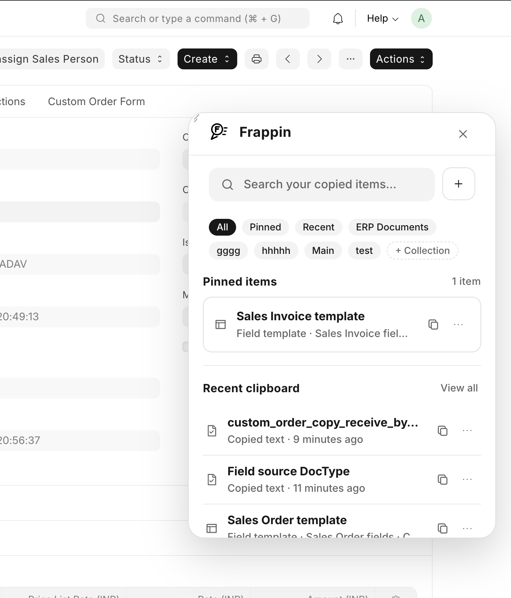
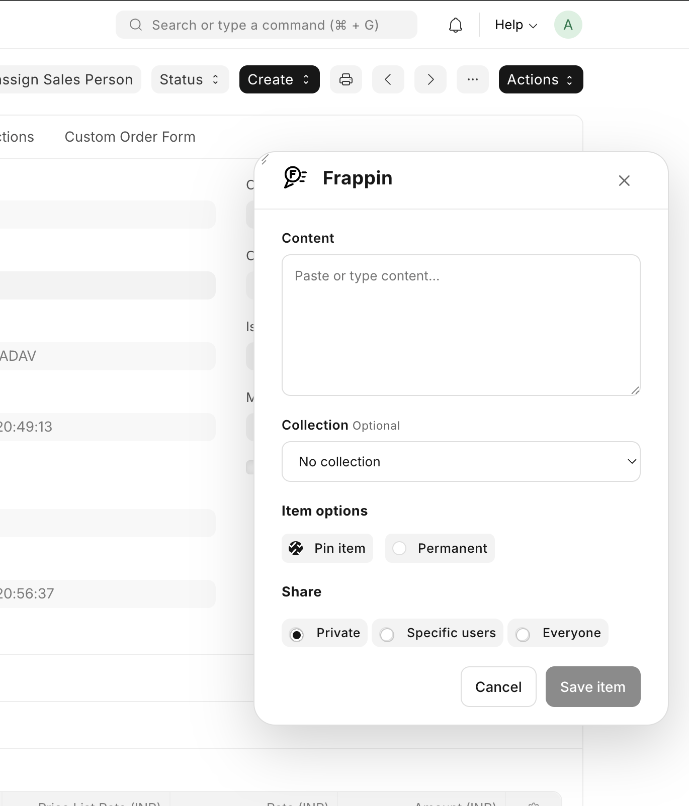

# Frappin

Frappin is a personal clipboard and reusable-template widget for the Frappe Framework. It appears as a movable floating button across Desk and website pages and gives signed-in users quick access to copied text, links, collections, shared snippets, and ERP form templates.

Frappin is a Frappe app and does not require ERPNext. ERPNext DocTypes become available automatically when ERPNext is installed on the same site.

## Features

- Global, movable Frappin launcher and resizable Vue panel
- Automatic capture of copied text
- Search, pin, permanent storage, editing, and deletion
- Personal collections with inline collection creation and filter chips
- Private items or sharing with selected users/everyone
- Separate view, edit, and delete sharing rights
- Configurable automatic cleanup of non-permanent items
- ERP templates that fill matching editable fields on any open DocType form
- Click or drag-and-drop template application
- Custom field names and child-table rows
- Five-item incremental loading while scrolling

## Screenshots

### Settings

Use **Frappin Settings** to enable or disable the widget and configure automatic deletion of non-permanent items.



### Clipboard list

Search clipboard items, filter by collection, access pinned and recent items, or create a collection directly from the panel.



### Item creation

Create an item, assign a collection, pin it, keep it permanently, and configure sharing without leaving the Frappin panel.



## Requirements

- A working Frappe Bench installation
- A Frappe site
- Python 3.10 or newer
- Node/Yarn versions supported by the installed Frappe release
- Redis workers and the Frappe scheduler for background cleanup
- HTTPS or `localhost` when browser Clipboard API access is required

## Compatibility

Frappin is designed to work across all Frappe versions that meet the runtime requirements listed above. The same `develop` branch is used for every Frappe version; a separate Frappin branch is not required for each Frappe major release.

The app stays version-independent by using standard Frappe capabilities:

- DocTypes and document controllers
- Whitelisted Python APIs
- Permission query and document permission hooks
- Scheduler events
- Standard asset hooks and the Frappe asset builder
- Public Frappe form APIs for template application
- No direct ERPNext imports or ERPNext dependency

ERPNext is optional. When it is installed, Frappin discovers its DocTypes and fields through Frappe metadata. The same behavior also works with DocTypes supplied by other custom apps.

Check the Frappe version installed in a Bench with:

```bash
bench version
```

The current development environment uses Frappe `15.119.1`. When using another Frappe release, use that release's supported Python, Node, Yarn, Redis, and database versions. For production upgrades, always validate the combined Bench on a staging site because framework-level behavior and infrastructure requirements can change independently of Frappin.

## Installation

Run these commands from your Frappe Bench directory. Replace `your-site.localhost` with the real site name.

```bash
cd /path/to/frappe-bench

bench get-app --branch develop https://github.com/devlpr-nitish/frappin.git
bench --site your-site.localhost install-app frappin
bench --site your-site.localhost migrate
bench build --app frappin
bench --site your-site.localhost clear-cache
```

In production, restart the Bench processes after installation:

```bash
bench restart
```

If Bench is running in Docker, execute the same commands inside the container that owns the Bench directory. For immutable production images, add Frappin while building the image rather than installing it into a running disposable container.

Confirm the installation:

```bash
bench --site your-site.localhost list-apps
```

`frappin` should appear in the result.

## Initial configuration

1. Sign in as a System Manager.
2. Open **Frappin Settings** from the Awesome Bar.
3. Leave **Disabled** unchecked to show the widget.
4. Set the number of retention days. The default is 2 days.
5. Ensure the scheduler is enabled if automatic cleanup is required:

```bash
bench --site your-site.localhost enable-scheduler
bench --site your-site.localhost scheduler status
```

The widget is available only to authenticated users. Changing **Disabled** may require a cache clear and browser refresh:

```bash
bench --site your-site.localhost clear-cache
```

## How Frappin works

### Clipboard items

When a user copies text from an input, textarea, selected page content, or supported programmatic clipboard action, Frappin stores it as a user-owned **Frappin Clipboard Item**. Content is size-limited and deduplicated per owner.

Users can:

- Click ordinary item text to copy it again.
- Pin frequently used items.
- Mark items as permanent so retention cleanup does not delete them.
- Organize items into personal collections.
- Edit or delete items from the three-dot menu.
- Share an item privately, with selected users, or with everyone.

### Retention

The daily scheduler job removes non-permanent clipboard items older than the retention period configured in **Frappin Settings**. Permanent items are excluded from cleanup.

### Collections

Collections are personal filters. Select **+ Collection** beside the filter chips, enter a name, and press Enter. The newly created collection becomes the active filter and is also available in the create/edit item form.

### ERP templates

Create a clipboard item and select **ERP template** as the item type.

1. Search for and select a **Field source DocType**.
2. Choose suggested field names or type custom Frappe field names.
3. Enter the values to apply.
4. Save the template.
5. Open a draft Frappe form and click the template, or drag it onto the form.

The source DocType supplies field suggestions only. A template can be applied to any DocType containing matching editable field names. Missing, hidden, and read-only fields are skipped. Applying a template changes the open form but does not save it automatically, so normal Frappe validation and permissions remain active.

For example, a template containing `company`, `currency`, and `territory` can fill those fields on any form where they exist and are editable.

#### Child tables

Use an indexed path to define child-table values:

```text
items[1].item_code = ITEM-001
items[1].qty       = 2
items[2].item_code = ITEM-002
items[2].qty       = 5
```

The first number is the child-row position. Fields sharing the same table name and index are grouped into one child row. When applied, Frappin replaces only the child tables explicitly included in the template; unrelated child tables remain unchanged.

## Permissions and privacy

- Clipboard items and collections are assigned to the current user on the server.
- Users can only use their own collections.
- Private items are visible only to their owner unless explicitly shared.
- Shared edit and delete operations are checked by the backend.
- ERP templates only update editable fields on the currently open draft form.
- Saving the resulting ERP document still uses normal Frappe permissions and validation.

Clipboard content may contain sensitive information. Administrators should establish an appropriate retention policy and users should share items carefully.

## Updating

Back up the site before upgrading the app:

```bash
cd /path/to/frappe-bench
bench --site your-site.localhost backup

cd apps/frappin
git pull origin develop
cd ../..

bench --site your-site.localhost migrate
bench build --app frappin
bench --site your-site.localhost clear-cache
bench restart
```

Always test Frappin on a staging site before upgrading Frappe to a new major version.

## Uninstallation

Back up the site first. Uninstalling removes the app's DocTypes and stored Frappin data from that site.

```bash
cd /path/to/frappe-bench
bench --site your-site.localhost backup
bench --site your-site.localhost uninstall-app frappin
bench remove-app frappin
```

## Troubleshooting

### The floating button does not appear

- Confirm the user is signed in.
- Confirm **Disabled** is unchecked in Frappin Settings.
- Run `bench build --app frappin` and clear the site cache.
- Hard-refresh the browser.
- Check the browser console and Frappe error logs.

### Copied text is not captured

- Use HTTPS or localhost so the browser can permit clipboard operations.
- Check browser clipboard permissions.
- Some browser or operating-system copy actions cannot be observed by a webpage.

### Old items are not deleted

- Confirm the scheduler and workers are running.
- Check that the item is not marked permanent.
- Verify the retention value in Frappin Settings.

```bash
bench --site your-site.localhost scheduler status
bench doctor
```

### Templates do not fill a field

- The form must be a draft.
- The field name must match exactly.
- The field must exist and be editable on the current form.
- For child fields, use the `table_field[row].child_field` format.

## Contributing

Contributions are welcome through GitHub issues and pull requests.

### 1. Fork and clone

Fork [devlpr-nitish/frappin](https://github.com/devlpr-nitish/frappin), then add your fork to an existing Frappe Bench:

```bash
cd /path/to/frappe-bench
bench get-app --branch develop https://github.com/YOUR_GITHUB_USERNAME/frappin.git
bench --site your-site.localhost install-app frappin
bench --site your-site.localhost migrate
```

If Frappin is already installed from the upstream repository, replace the Git remote with your fork or add your fork as another remote:

```bash
cd /path/to/frappe-bench/apps/frappin
git remote add fork https://github.com/YOUR_GITHUB_USERNAME/frappin.git
```

### 2. Create a branch

Start from the latest `develop` branch and use a focused branch name:

```bash
git checkout develop
git pull origin develop
git checkout -b feature/short-description
```

Use prefixes such as `feature/`, `fix/`, `docs/`, or `refactor/`.

### 3. Install development checks

Install pre-commit and enable the repository hooks:

```bash
cd /path/to/frappe-bench/apps/frappin
python -m pip install pre-commit
pre-commit install
```

The hooks run Ruff, Ruff Format, Prettier, ESLint, PyUpgrade-related checks, and common file validations.

### 4. Make and validate the change

Keep backend APIs in `frappin/api`, scheduled jobs in `frappin/jobs`, Vue components in `frappin/public/js`, and widget styles in the separate CSS bundle.

Run the relevant checks before committing:

```bash
cd /path/to/frappe-bench/apps/frappin
pre-commit run --all-files

cd /path/to/frappe-bench
bench build --app frappin
bench --site your-site.localhost migrate
bench --site your-site.localhost clear-cache
```

Also test the affected workflow manually with a non-Administrator user. Changes involving sharing, collections, templates, or deletion should verify backend permissions as well as the user interface.

When changing a DocType:

- Update its exported JSON definition.
- Add a patch when existing data requires a migration or transformation.
- Run `bench --site your-site.localhost migrate`.
- Confirm that upgrades preserve existing clipboard items and settings.

### 5. Commit and open a pull request

```bash
cd /path/to/frappe-bench/apps/frappin
git status
git add README.md path/to/changed-file
git commit -m "feat: describe the change"
git push fork feature/short-description
```

Open a pull request into the upstream `develop` branch. The pull request should include:

- The problem and proposed solution
- Frappe version used for testing
- Installation or migration notes, when applicable
- Screenshots or a short recording for interface changes
- Tests performed and their results
- Any compatibility or security considerations

Keep pull requests focused. Avoid mixing formatting-only changes or unrelated refactors with a feature or bug fix.

### Reporting bugs

Open a GitHub issue with the Frappe version, Frappin commit or branch, browser, reproduction steps, expected behavior, actual behavior, and relevant browser-console or server-log output. Remove passwords, tokens, clipboard content, and other sensitive data before attaching logs.

## License

[MIT](license.txt)
